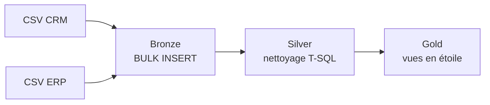
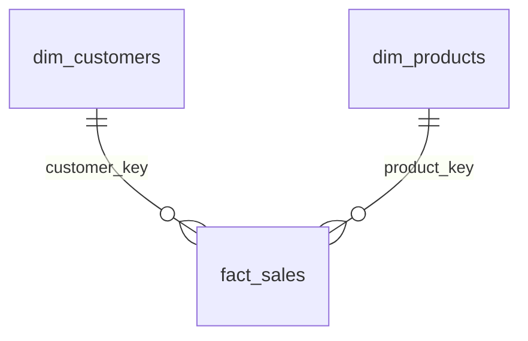

# Entrepôt de données SQL Server (CRM + ERP)

**Auteur :** donia-fioklou

## Problématique

Les ventes sont réparties entre un CRM et un ERP, dans des CSV aux formats incohérents (doublons, codes M/F/S, dates en entier, prix et montants incohérents). Comment obtenir un modèle unique et fiable pour analyser clients, produits et ventes ?

## Solution : une architecture en 3 couches sur SQL Server



### Bronze : charger les CSV tels quels

- **Problème :** les sources sont des fichiers plats, et un rechargement ne doit pas dupliquer les données.
- **Solution :** tables `bronze.*` identiques aux CSV, remplies par la procédure `bronze.load_bronze` (`TRUNCATE` puis `BULK INSERT`), avec durée de chargement et gestion d’erreurs `TRY/CATCH`.

### Silver : corriger les données

La procédure `silver.load_silver` applique ces corrections :

| Problème constaté | Technique SQL |
|---|---|
| Plusieurs lignes par client | `ROW_NUMBER() OVER (PARTITION BY cst_id ORDER BY cst_create_date DESC)` pour garder la plus récente |
| Codes `M`, `F`, `S`, `R`, `T`… | `CASE` + `UPPER(TRIM())` vers des libellés lisibles, `n/a` si inconnu |
| Clé produit qui mélange catégorie et produit | `SUBSTRING` / `REPLACE` pour extraire `cat_id` et `prd_key` |
| Historique de prix sans date de fin | `LEAD()` pour calculer `prd_end_dt` à partir de la date de début suivante |
| Dates stockées en entier (`20240131`) ou à `0` | Conversion en `DATE`, `NULL` si invalide |
| Montant, quantité et prix incohérents | Recalcul de `sales = quantity × price` ou du prix quand une valeur est absente ou négative |
| Identifiants ERP différents du CRM (`NAS…`, tirets) | `SUBSTRING` / `REPLACE` pour aligner les clés |
| Dates de naissance futures | Remplacées par `NULL` |
| Pays codés de façon hétérogène (`DE`, `US`, `USA`, vide) | Normalisation en noms complets ou `n/a` |

### Gold : exposer un modèle d’analyse

- **Problème :** les analystes ne doivent pas réécrire les jointures CRM/ERP.
- **Solution :** trois vues dans `scripts/gold/ddl_gold.sql`.
  - `gold.dim_customers` : CRM + ERP (naissance, pays), avec genre ERP en repli quand le CRM est inconnu.
  - `gold.dim_products` : produits actuels uniquement (`prd_end_dt IS NULL`), enrichis par catégorie et sous-catégorie ERP.
  - `gold.fact_sales` : ventes reliées aux dimensions par des clés de substitution générées avec `ROW_NUMBER()`.



Le détail des colonnes est dans le [catalogue de données](docs/data_catalog.md) ; les règles de nommage sont dans les [conventions](docs/naming_conventions.md).

## Exécution rapide

1. Dans `scripts/bronze/proc_load_bronze.sql`, remplacer les chemins absolus des CSV par ceux de votre machine.
2. Exécuter dans SSMS, dans cet ordre :
   `scripts/init_database.sql`, `scripts/bronze/ddl_bronze.sql`, `scripts/silver/ddl_silver.sql`, `scripts/bronze/proc_load_bronze.sql`, `scripts/silver/proc_load_silver.sql`, `scripts/gold/ddl_gold.sql`.
3. Charger les données :

```sql
EXEC bronze.load_bronze;
EXEC silver.load_silver;
SELECT TOP (10) * FROM gold.fact_sales;
```

> `init_database.sql` supprime et recrée la base `DataWarehouse`.

## Vérification de la qualité

Les scripts [quality_checks_silver.sql](tests/quality_checks_silver.sql) et [quality_checks_gold.sql](tests/quality_checks_gold.sql) contrôlent les doublons de clés, les espaces parasites, la cohérence des dates et des montants, l’unicité des clés de substitution et l’intégrité des jointures entre faits et dimensions.

## Crédit

Projet réalisé en m’appuyant sur la formation de [Data With Baraa](https://www.youtube.com/@datawithbaraa).
