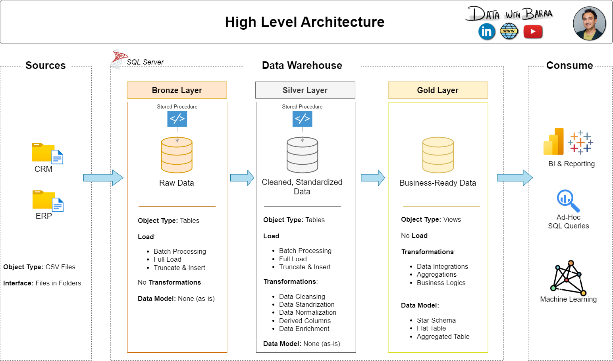

# Entrepôt de données SQL — projet de Donia

> Projet personnel d’apprentissage en ingénierie des données, réalisé avec SQL Server.

**Auteur :** donia-fioklou

J’ai réalisé ce projet pour apprendre et pratiquer les étapes de construction d’un entrepôt de données : chargement de fichiers CSV, nettoyage et intégration de données, modélisation analytique et contrôles qualité. Le projet s’appuie sur deux sources, CRM et ERP, et organise les données selon les couches Bronze, Silver et Gold.

Cette réalisation s’inspire du projet pédagogique de **Data With Baraa**. Le code et la documentation de ce dépôt correspondent à mon travail d’apprentissage et à mon adaptation du projet.

## Architecture

Les scripts SQL Server mettent en place trois couches :

1. **Bronze** — chargement des CSV sources sans transformation métier majeure.
2. **Silver** — nettoyage, standardisation et harmonisation des données CRM et ERP.
3. **Gold** — trois vues analytiques organisées en modèle en étoile : `dim_customers`, `dim_products` et `fact_sales`.



Le flux des données est illustré dans [le diagramme de flux](docs/data_flow.png). Le détail des colonnes Gold est disponible dans le [catalogue de données](docs/data_catalog.md).

## Ce que contient le projet

- Une base SQL Server créée avec les schémas `bronze`, `silver` et `gold`.
- Des tables Bronze et Silver pour les fichiers CRM et ERP.
- Des procédures de chargement Bronze et Silver, avec transformations et standardisations dans Silver.
- Des vues Gold pour l’analyse des clients, des produits et des ventes.
- Des requêtes de contrôle qualité pour les couches Silver et Gold.
- Des notes et diagrammes de conception dans `docs/`.

Le modèle Gold est destiné à faciliter les analyses de ventes, de produits et de clients. Ce dépôt ne contient pas de tableau de bord BI ni de rapports d’analyse prêts à l’emploi.

## Technologies et prérequis

- Microsoft SQL Server.
- SQL Server Management Studio (SSMS), ou un outil compatible pour exécuter les scripts T-SQL.
- Accès en lecture aux fichiers CSV depuis le service SQL Server pour utiliser `BULK INSERT`.

## Exécution

### 1. Vérifier les chemins des CSV

La procédure `bronze.load_bronze`, dans `scripts/bronze/proc_load_bronze.sql`, contient des chemins absolus propres à une machine. Avant de la créer ou de l’exécuter, remplace ces chemins par ceux des fichiers CSV dans ton environnement. Le compte de service SQL Server doit pouvoir lire ces fichiers.

### 2. Créer la base et les objets

Dans SSMS, exécute les scripts dans cet ordre :

1. `scripts/init_database.sql`
2. `scripts/bronze/ddl_bronze.sql`
3. `scripts/silver/ddl_silver.sql`
4. `scripts/bronze/proc_load_bronze.sql`
5. `scripts/silver/proc_load_silver.sql`
6. `scripts/gold/ddl_gold.sql`

> **Attention :** `scripts/init_database.sql` supprime puis recrée la base `DataWarehouse` si elle existe déjà. Cette opération efface les données qu’elle contient.

### 3. Charger les données

Après avoir configuré les chemins CSV, exécute les procédures dans l’ordre :

```sql
EXEC bronze.load_bronze;
EXEC silver.load_silver;
```

Les vues Gold sont définies dans `scripts/gold/ddl_gold.sql`. Une fois les couches chargées, tu peux les interroger, par exemple :

```sql
SELECT TOP (10) *
FROM gold.fact_sales;
```

Les procédures vident leurs tables cibles avant chaque chargement. Relancer un chargement remplace donc les données déjà présentes dans la couche concernée.

### 4. Vérifier la qualité des données

Après les chargements, exécute les requêtes de `tests/quality_checks_silver.sql` et `tests/quality_checks_gold.sql` dans SSMS. Les commentaires de ces fichiers précisent les résultats attendus pour chaque contrôle.

## Structure du dépôt

```text
.
├── datasets/
│   ├── source_crm/             # Fichiers CSV du CRM
│   └── source_erp/             # Fichiers CSV de l’ERP
├── docs/
│   ├── data_catalog.md
│   ├── naming_conventions.md
│   ├── ETL.png
│   ├── data_architecture.png
│   ├── data_flow.png
│   ├── data_integration.png
│   ├── data_model.png
│   ├── data_layers.pdf
│   └── Project_Notes_Sketches.pdf
├── scripts/
│   ├── init_database.sql
│   ├── bronze/
│   ├── silver/
│   └── gold/
├── tests/
│   ├── quality_checks_silver.sql
│   └── quality_checks_gold.sql
├── LICENSE
└── README.md
```

## Documentation

- [Catalogue des données Gold](docs/data_catalog.md)
- [Conventions de nommage](docs/naming_conventions.md)
- [Architecture des données](docs/data_architecture.png)
- [Flux de données](docs/data_flow.png)

## Inspiration et crédits

Projet inspiré par les ressources pédagogiques de [Data With Baraa sur YouTube](https://www.youtube.com/@datawithbaraa). Merci à Baraa pour le contenu qui m’a aidée à apprendre et à réaliser ce projet.
